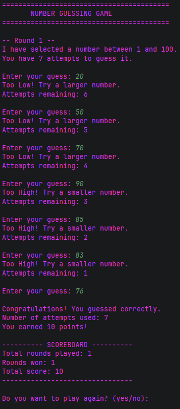
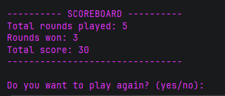
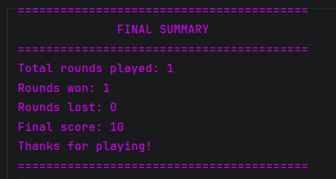

# Number Guessing Game in Java

A simple command-line Number Guessing Game built using Java. Developed as part of my Java Development Internship at Oasis Infobyte.

## How the Game Works

- The computer picks a random number between 1 and 100.
- You get **7 attempts** in each round to guess the correct number.
- After every incorrect guess, the game gives a hint: `Too High` or `Too Low`.
- Invalid inputs don't consume your attempts.
- You can play multiple rounds, and your score is updated along the way.
- At the end, the game displays your overall performance.

## Requirements & Setup

- **JDK:** Version 17 or higher
- **IDE:** IntelliJ IDEA or any other Java IDE

### How to Run

1. Clone or download this repository.
2. Open the project folder in your IDE.
3. Open `src/NumberGuessingGame.java`.
4. Run the `main()` method to start playing.

## Screenshots

Screenshots of the Game.

### Gameplay


### Scoreboard


### Final Summary


## Project Structure

```text
JavaDev-Task2-NumberGuessingGame/
│
├── screenshots/
│   ├── 1-gameplay.png
│   ├── 2-scoreboard.png
│   └── final-summary.png
│
├── src/
│   └── NumberGuessingGame.java
│
├── .gitignore
└── README.md
```

## Technologies Used

- Java
- Scanner
- Random
- Loops and conditional statements
