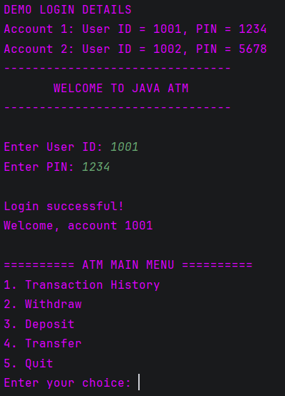
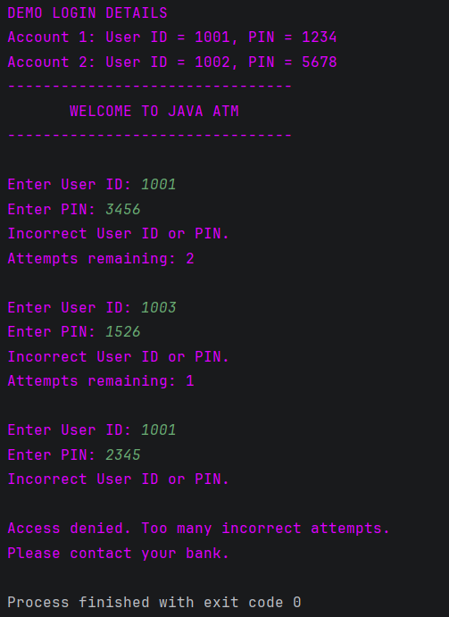
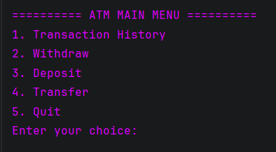
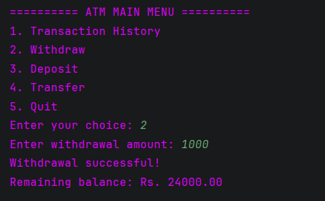
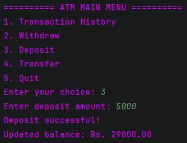
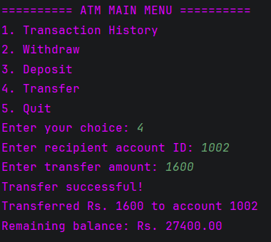
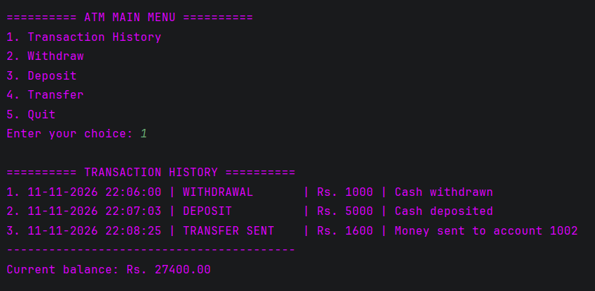
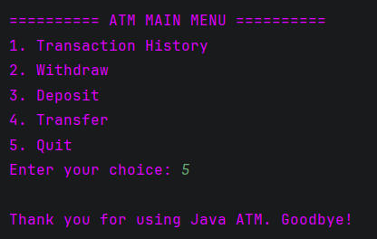

# ATM Interface - Java Console Application

## Project Overview
A console-based ATM simulation developed using Java and
Object-Oriented Programming (OOP).

## Technology Used
- Java
- OOP
- ArrayList
- HashMap
- BigDecimal
- LocalDateTime
- Scanner

## Features
1. User authentication using User ID and PIN.
2. Maximum three incorrect login attempts.
3. Transaction history.
4. Cash withdrawal.
5. Cash deposit.
6. Money transfer between accounts.
7. Insufficient balance validation.
8. Input validation.
9. Exit functionality.

## Screenshots

### 1. Login


### 2. Invalid Login


### 3. Main Menu


### 4. Withdrawal


### 5. Deposit


### 6. Transfer


### 7. Transaction History


### 8. Quit


## Project Structure

```text

ATM-Interface/
│
├── src/
│   ├── Account.java
│   ├── ATM.java
│   ├── Bank.java
│   ├── Main.java
│   └── Transaction.java
│
├── screenshots/
│   ├── 1-login.png
│   ├── 2-invalid-login.png
│   ├── 3-main-menu.png
│   ├── 4-withdrawal.png
│   ├── 5-deposit.png
│   ├── 6-transfer.png
│   ├── 7-transaction-history.png
│   └── 8-Quit.png
│
└──.gitignore
└── README.md
```
## Demo Credentials

Account 1:
User ID: 1001
PIN: 1234
Balance: Rs. 25000

Account 2:
User ID: 1002
PIN: 5678
Balance: Rs. 10000

## How to Run

Compile:
javac -d out src/Main.java src/ATM.java src/Account.java src/Transaction.java src/Bank.java

Run:
java -cp out Main

## OOP Concepts Used
- Encapsulation
- Abstraction
- Classes and Objects
- Constructors
- Methods
- Collections

## Limitations
- Data is stored in memory.
- Transactions reset after restarting.
- Demo PINs are not securely stored.
- No real bank integration.

## Future Improvements
- Database integration.
- Secure PIN hashing.
- Account creation.
- PIN changing functionality.
- Daily transaction limits.
